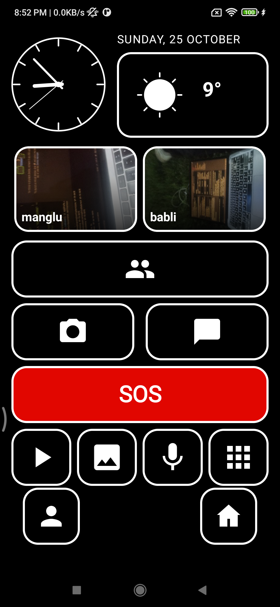
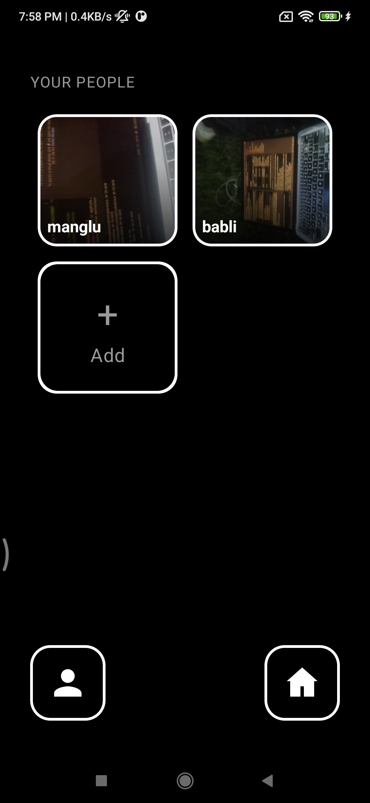
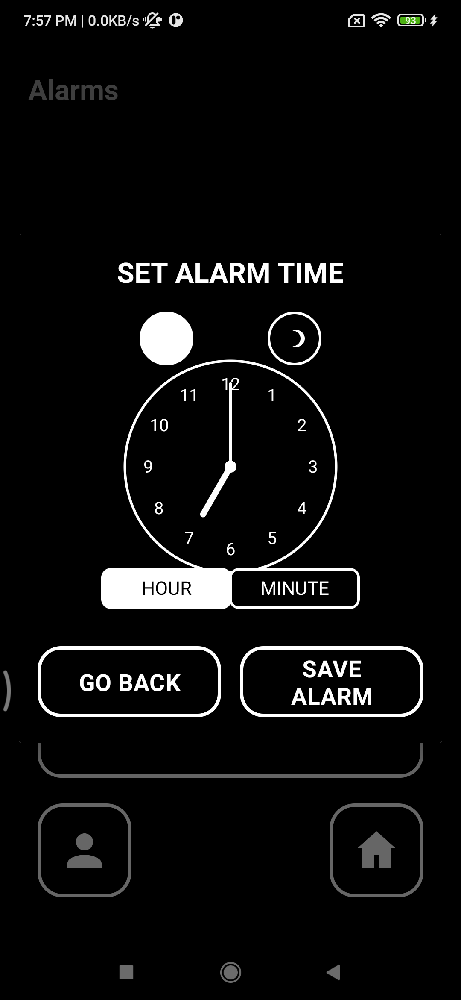
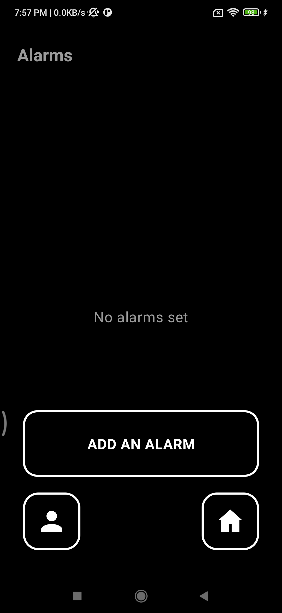
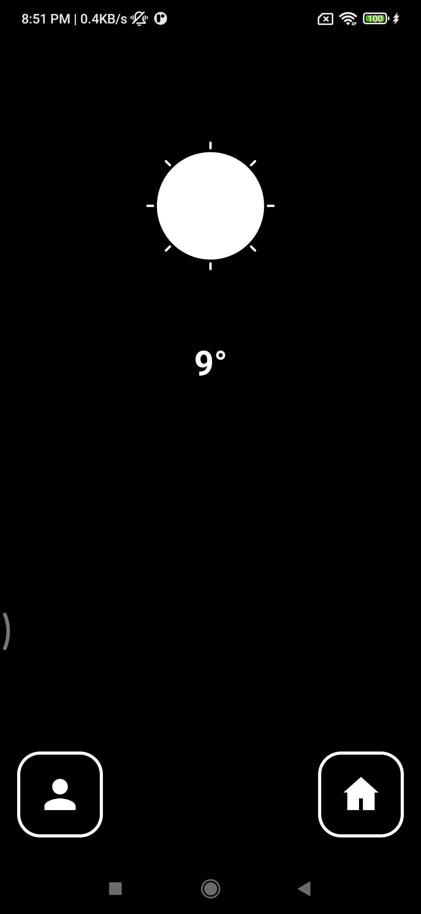
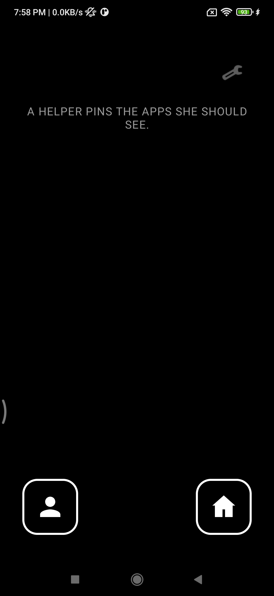
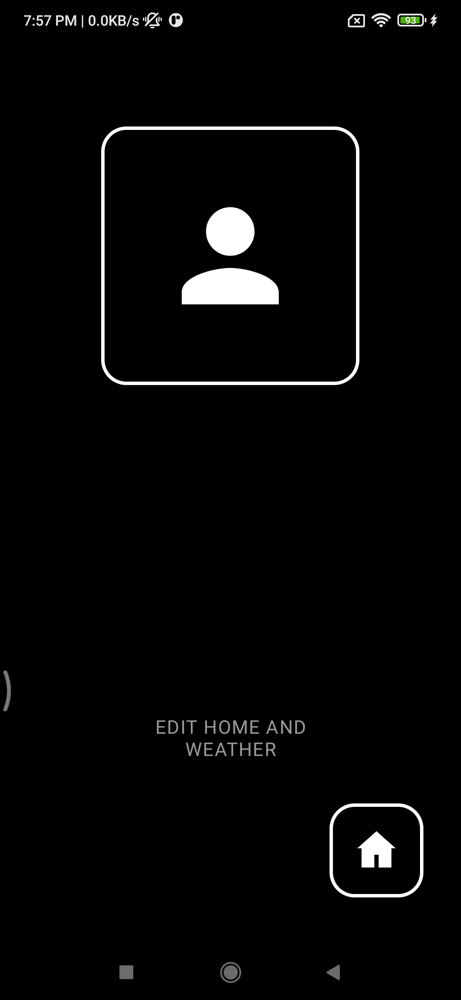
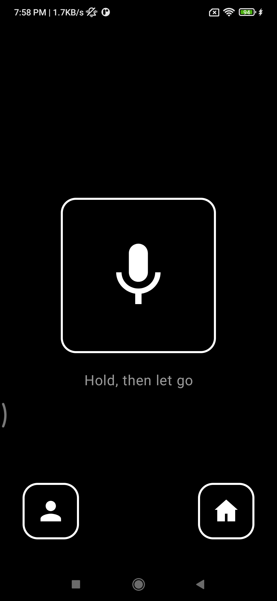
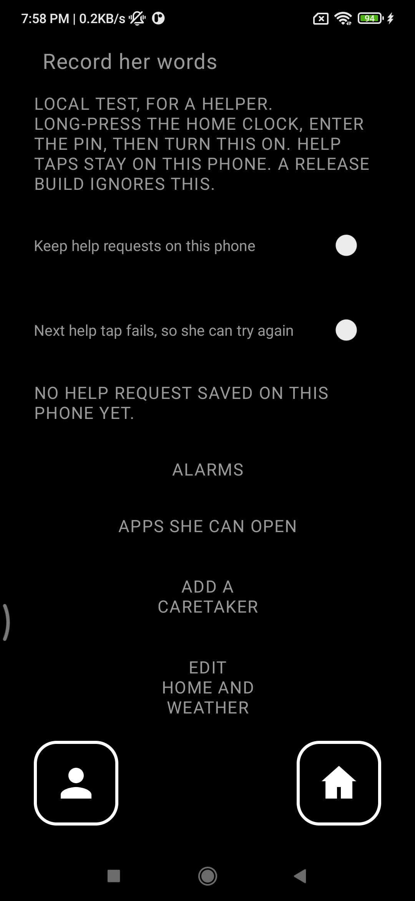

# Grandma's Launcher

An Android home screen for a grandmother who does not read, has low vision, and has a hand tremor. She finds people by their photos, the clock, and colour. Family caretakers set the phone up and watch it from a separate web app. The phone and the caretakers talk only through the backend.

## The three repositories

| App | Repository |
|---|---|
| This launcher (Kotlin, XML views) | [akshayrivers/Grandmaz_Launcher](https://github.com/akshayrivers/Grandmaz_Launcher) |
| Backend (Fastify, Postgres) | [akshayrivers/Grandmaz_Backend](https://github.com/akshayrivers/Grandmaz_Backend) |
| Caretaker web app | [akshayrivers/Grandmaz_Caretaker](https://github.com/akshayrivers/Grandmaz_Caretaker) |

On a local machine the siblings are `sys-launcher`, `dadi's Backend`, and `Dadi's Caretaker`. API fields are camelCase.

The launcher registers the phone, keeps a device token, and polls for queued commands. The caretaker site signs in with Firebase and edits config, help, and SOS. This app does not open a live view of her screen.

## Build, install, test

JDK 21. From this directory:

```bash
./gradlew :app:assembleDebug
./gradlew :app:installDebug
./gradlew :app:testDebugUnitTest
./gradlew :app:lint
```

`installDebug` needs a device or emulator. `compileSdk` and `targetSdk` are 36. `minSdk` is 26. The app does not request `QUERY_ALL_PACKAGES`.

The backend base URL is build config, not a constant in Kotlin. Debug and release both default to `https://grandmaz-backend.onrender.com/`. For a machine you control, pass a URL when you build the debug app:

```bash
./gradlew :app:assembleDebug -Pgrandma.devBackendUrl=http://10.0.2.2:3000/
```

`10.0.2.2` is the emulator's name for the computer running the API. Release builds ignore that property and stay on `https://grandmaz-backend.onrender.com/`. Cleartext HTTP is debug-only, and only for hosts listed in `app/src/debug/res/xml/network_security_config.xml` (`localhost`, `127.0.0.1`, and `10.0.2.2` are already there). Add a `<domain>` entry before using another `http://` host. Release builds do not allow cleartext.

Run the backend from its own repository with `npm run dev` (port 3000) before pairing. Do not commit `local.properties`, keystores, or `google-services.json`.

## Setup and pairing

1. Install the launcher and complete the on-phone setup. A helper enters the caretaker's email. The phone shows a pairing code. There is no Google sign-in on grandma's phone.
2. The caretaker opens the magic link on their own device, signs in, and accepts. The first caretaker to link is the primary. There is exactly one primary.
3. The caretaker PIN is created on grandma's phone. It never goes to the server, a snapshot, or a remote command.

After signature verification the phone stores a device token and uses it on later calls. It pulls a versioned config document (people, weather city, reminders, voice clips, the Gemini model id) and caretaker edits are saved back with `If-Match`. Pending commands are picked up by a WorkManager sync about every 15 minutes, and by on-demand syncs. Nothing wakes the phone from a push.

## Rules that must not be regressed

- Photos, icons, colour, position, and the analog clock come before words. The home clock has tick marks and no numerals.
- One action on a grandma-facing screen. Touch targets are at least 80dp, and primary actions are at least 100dp.
- No hidden gestures for her actions. A long-press is only for a helper (the clock long-press opens caretaker mode after the PIN).
- Every sub-screen has a house control, and a quiet period returns to home.
- The page is black with white borders. Red `#E10600` is SOS only.
- The theme stays light, and night mode is locked off so the black-and-white chrome is not swapped.
- Do not add Toasts as feedback for grandma. Speak, show a picture, or vibrate.
- English on screen is for the helper. Her labels are spoken: a recorded clip, then Hindi TTS, then English, then a vibration. Dogri is a recorded clip only.
- SOS is a 3 second hold. The phone then calls the primary caretaker's number when it knows one, otherwise 112. `ACTION_CALL` is used when `CALL_PHONE` is granted, otherwise `ACTION_DIAL`. Alerts with location go to the backend. Stopping alerts does not hang up. If the alert cannot be posted and SMS fallback is on, the phone texts each known caretaker number a map link.
- Home shows pinned photos plus a way to the rest. The speech-bubble button starts a WhatsApp video call to one person, then a WhatsApp voice call, then a normal call.
- Weather is Open-Meteo: the caretaker's city first, then a coarse location, cached for about 45 minutes. No weather API key.
- The server is the intermediary. This app does not open a live view of the screen and does not remote-control the phone.
- No API key in the APK. Ask asks the backend for a short-lived Gemini token. The recording is not uploaded to this backend.

## Features

Screens from a local debug run. The chrome is black and white, with a red SOS button.

### Home



Home is the launcher. The analog clock has tick marks and no numerals, with the date beside it for a helper. The weather card shows an icon and a temperature. Pinned people are photos. Under them are people, camera, the WhatsApp speech bubble, and the red SOS button. The bottom row is YouTube, Gallery, Ask (the microphone), and apps. The person button asks for help. The house returns here.

### People



This is the people grid. Each person is a photo. Add is the large plus. A tap starts a call confirmation. A helper can import a phone contact, store more than one number, and mark WhatsApp.

### Alarm setter



A helper sets an alarm by moving the hour and minute hands. The sun is morning and the moon is night. Save stores the alarm. Go back leaves without saving.

### Alarms



The alarm list. This picture was taken when none were set. Add an alarm opens the setter. Medicine reminders are separate and come from the caretaker's home setup.

### Weather



The full-screen weather picture. She hears the day. The number is degrees from Open-Meteo. The house returns to Home.

### More apps



Apps she can open. The list stays empty until a helper pins packages. The helper reaches that list from caretaker mode. The launcher does not request permission to see every app on the phone.

### Ask for help



One picture. Tapping the person posts a help request the caretakers can read in their web app, then returns home. It does not push their phones. The words underneath are for a helper and open home and weather settings. If the request cannot be sent, she hears a prompt to try again.

### Ask



Ask stays inside this app. The screen is a large microphone, the words "Hold, then let go", and the help and home buttons. She holds the microphone and lets go. The phone's speech recognizer turns that into text. The app then asks the backend for a one-use Gemini token and sends the words, not the recording, to Gemini. The answer is spoken. If the server has no Gemini key, the screen says the helper is not available. Debug and release use this same screen. Neither build contains a Gemini API key, and Ask does not open the Gemini app.

To try it on a machine you control, set `GEMINI_API_KEY` in the backend `.env` (that file stays gitignored), run the API, point a debug build at it, and pair the phone so it has a device token. The caretaker site can save the model id. The default is `gemini-3.8-flash`.

### Record her words



This picture is the helper screen after a long-press on the home clock and the PIN. Hold a slot's microphone to replace that button's spoken words. The two switches at the top ("Keep help requests on this phone" and "Next help tap fails") are debug-only. A release build hides them. The links below open alarms, the apps she can open, adding a caretaker, and home and weather.

## Not done

- The Play Store listing is later. A release APK can be built, but the app is not published.
- Live screen viewing and remote control are not in this app.
- Firebase Cloud Messaging is not wired, so a push does not wake the phone. The phone syncs on its own schedule.
- Ask speaks only when the backend has `GEMINI_API_KEY`. The key stays in that server's environment. It is not in the release APK.
- Web push for caretakers is not configured.
